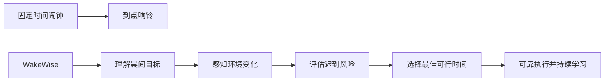
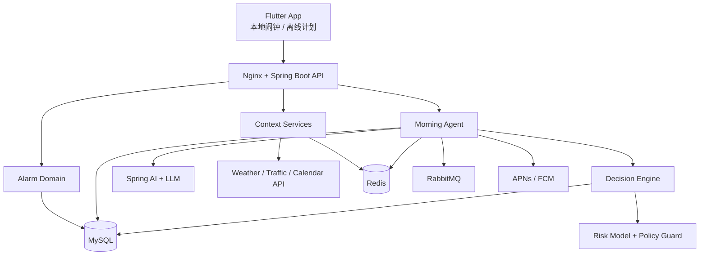

<div align="center">

# 知晨 WakeWise

### AI Morning Assistant

**让每一次起床，都恰到好处。**  

*Wake up at the right time, not just on time.*

[产品文档](./WakeWise-PRD与架构设计.md) · [API 设计](./WakeWise-API设计.md) · [数据库设计](./WakeWise-数据库设计.md) · [路线图](#路线图)

---

## 项目简介

WakeWise 是一款面向晨间场景的 AI 助手。它根据天气、交通、日历、用户行为和历史数据，评估次日晨间任务的迟到风险，在睡眠收益和履约风险之间计算最佳可行唤醒时间。

与传统闹钟不同，WakeWise 从用户真正的目标出发：不是在固定时间制造声音，而是帮助用户在合理的时间醒来，并顺利完成起床、准备、出发和到达。

> 当前仓库交付物为 v1.0 产品与架构基线；实现状态请以仓库 Issue、Milestone 和 Release 为准。

## 核心能力

- **目标型闹钟**：支持“几点起床”“几点出门”“几点到达”和日历事件四类目标。
- **环境感知**：融合小时级天气、气象预警、实时/预测交通和日历上下文。
- **风险决策**：用耗时分布和约束优化计算唤醒时间，不使用简单的天气固定权重。
- **行为学习**：持续校准贪睡延迟、准备时长、通勤偏差和建议接受偏好。
- **Morning Agent**：自动完成夜间采集、计划、校验、下发、通知和复盘。
- **可解释 AI**：每次调整展示幅度、主要因素、置信度、数据时间和撤销入口。
- **可靠执行**：云端负责计划，本地系统闹钟负责触发；新计划 ACK 前保留旧计划。
- **隐私优先**：最小权限、目的限制、敏感字段加密、数据导出与删除。

## 为什么不是“天气闹钟”



天气只是输入之一。WakeWise 的核心输出是一个受用户边界约束、可解释且可执行的 `WakePlan`。

## 产品截图

> 以下为截图占位符，完成 UI 实现后替换为真实设备截图或录屏。

| 首页 | 决策分析 | 历史统计 |
|---|---|---|
| `docs/assets/home-placeholder.png` | `docs/assets/analysis-placeholder.png` | `docs/assets/statistics-placeholder.png` |

## 系统架构



关键原则：

1. LLM 负责语义理解、工具编排和解释，不直接决定最终闹钟时间。
2. 决策引擎以硬约束、概率预测和策略优化生成可审计计划。
3. 移动端本地调度是响铃的最终执行面，推送不是唯一依赖。
4. 外部 API、网络和模型均允许失败，系统保留固定闹钟并支持降级。

## 技术栈

| 层级 | 技术 |
|---|---|
| Mobile | Flutter、Dart、iOS/Android 原生闹钟适配 |
| Backend | Java 21、Spring Boot、Spring Security、Quartz |
| AI | Spring AI（生产主框架）、LangChain4j（备选/实验）、LLM Provider |
| Data | MySQL 8、Redis |
| Messaging | RabbitMQ |
| Edge & Deploy | Nginx、Docker、Docker Compose |
| Integrations | Weather API、Traffic API、Calendar API、APNs、FCM |
| Observability | OpenTelemetry、Prometheus、Grafana、集中日志 |

## 核心决策模型

给定目标到达时间 `D`：

```text
RequiredTime = WakeLatency + PreparationTime + TravelTime + SafetyBuffer
CandidateWakeTime = D - Quantile(RequiredTime, q)
```

系统在用户允许的调整窗口内最小化：

```text
ExpectedLateCost + SleepLoss + PlanChangeCost + LowConfidencePenalty
```

事件越重要、数据尾部风险越大，采用的耗时分位越高；当数据不足或调整越界时，系统请求确认或保持原计划。

## 计划中的仓库结构

```text
WakeWise/
├── apps/
│   ├── mobile/                  # Flutter 客户端
│   └── server/                  # Spring Boot 模块化单体
├── packages/
│   └── api-contract/            # OpenAPI 与生成客户端
├── deploy/
│   ├── docker-compose.yml
│   └── nginx/
├── docs/
│   ├── WakeWise-PRD与架构设计.md
│   ├── WakeWise-API设计.md
│   ├── WakeWise-数据库设计.md
│   └── assets/
├── .env.example
├── LICENSE
└── README.md
```

## Getting Started

> 下列命令是目标工程的标准启动方式；在代码模块合入前，当前文档仓库无需运行环境。

### 环境要求

- JDK 21+
- Flutter stable
- Docker 24+ 与 Docker Compose v2
- MySQL 8+、Redis 7+、RabbitMQ 3.13+（建议由 Compose 启动）

### 1. 克隆仓库

```bash
git clone https://github.com/<your-org>/wakewise.git
cd wakewise
```

### 2. 配置环境变量

```bash
cp .env.example .env
```

最小配置项：

```dotenv
MYSQL_DATABASE=wakewise
MYSQL_USER=wakewise
MYSQL_PASSWORD=change-me
REDIS_HOST=redis
RABBITMQ_HOST=rabbitmq
WEATHER_API_KEY=replace-me
TRAFFIC_API_KEY=replace-me
LLM_API_KEY=replace-me
```

密钥只应进入本地 `.env` 或生产 Secret Manager，不得提交到 Git。

### 3. 启动基础设施

```bash
docker compose -f deploy/docker-compose.yml up -d mysql redis rabbitmq
```

### 4. 启动后端

```bash
cd apps/server
./gradlew bootRun
```

Windows：

```powershell
cd apps/server
.\gradlew.bat bootRun
```

### 5. 启动移动端

```bash
cd apps/mobile
flutter pub get
flutter run
```

### 6. 健康检查

```bash
curl http://localhost:8080/actuator/health
```

## 部署

### 单机/演示环境

使用 Docker Compose 运行 Nginx、Server、MySQL、Redis 和 RabbitMQ。移动端配置对应 API Base URL。

```bash
docker compose -f deploy/docker-compose.yml up -d --build
```

### 生产环境建议

- 应用容器无状态部署，至少两个副本；Quartz 使用 JDBC JobStore 和集群锁。
- MySQL 使用托管高可用实例，Redis 开启持久化/副本，RabbitMQ 使用 quorum queue。
- TLS 在 Nginx 或云负载均衡终止；密钥进入 KMS/Secret Manager。
- 为外部 API 设置超时、舱壁、熔断、预算和缓存降级。
- 发布采用数据库向前兼容迁移、灰度策略和可回滚模型版本。
- 云服务故障不影响移动端已落地的本地闹钟。

## 路线图

- [ ] **MVP**：目标型闹钟、天气/日历、规则决策、本地兜底、解释与撤销
- [ ] **V1**：交通预测、分位风险、晨间简报、完整审计与降级
- [ ] **V2**：行为学习、个体校准、周报、模型影子评估
- [ ] **V3**：可穿戴、智能家居、车辆与多设备协同
- [ ] **V4**：Morning OS、MCP 工具、开放 API 与 Agent 网络

## 文档

- [完整 PRD 与软件架构](./WakeWise-PRD与架构设计.md)
- [REST API 设计](./WakeWise-API设计.md)
- [数据库设计](./WakeWise-数据库设计.md)
- [简历、面试与路演材料](./WakeWise-简历与项目路演.md)

## 贡献指南

欢迎通过 Issue 和 Pull Request 参与。提交前请遵循：

1. 先用 Issue 描述问题、用户价值和建议边界。
2. 一个 PR 只解决一个清晰问题，避免混入无关重构。
3. 新增决策规则需提供场景、测试样例、失效策略和解释文案。
4. 涉及位置、日历、健康或行为数据时，必须补充隐私影响说明。
5. 涉及闹钟执行链路时，必须验证断网、重复消息、旧计划保留和设备 ACK。

建议采用 Conventional Commits：

```text
feat(alarm): add arrive-by target type
fix(agent): preserve previous plan before device ack
docs(api): document low-confidence response
```

## 安全

请勿在公开 Issue 中提交 API Key、访问令牌、精确地址、日历内容或健康数据。安全漏洞请通过仓库 `SECURITY.md` 中的私密渠道报告。

## License

建议使用 [Apache License 2.0](https://www.apache.org/licenses/LICENSE-2.0)，以便开源协作并明确专利授权。正式发布前请在仓库根目录加入完整 `LICENSE` 文件；如商业策略不同，可由项目所有者改用其他许可证。

---

<div align="center">

**WakeWise — Wake up at the right time, not just on time.**

</div>

