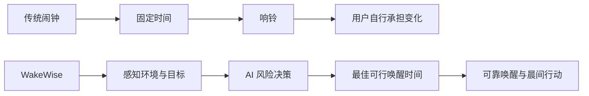
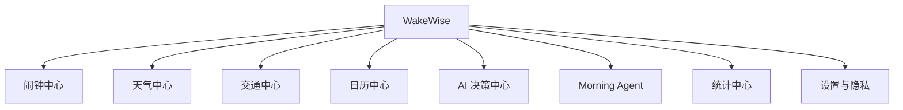
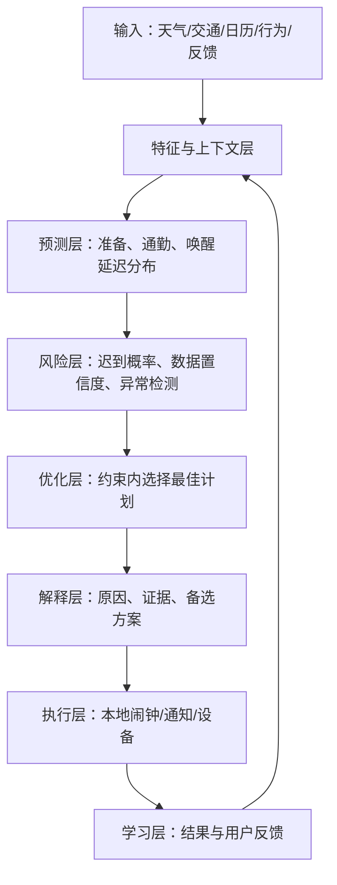
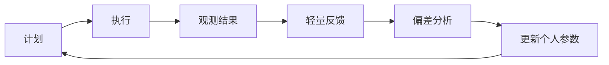
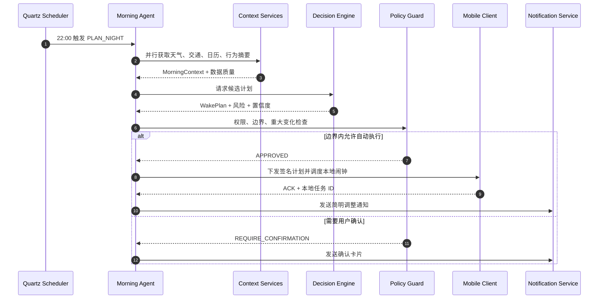
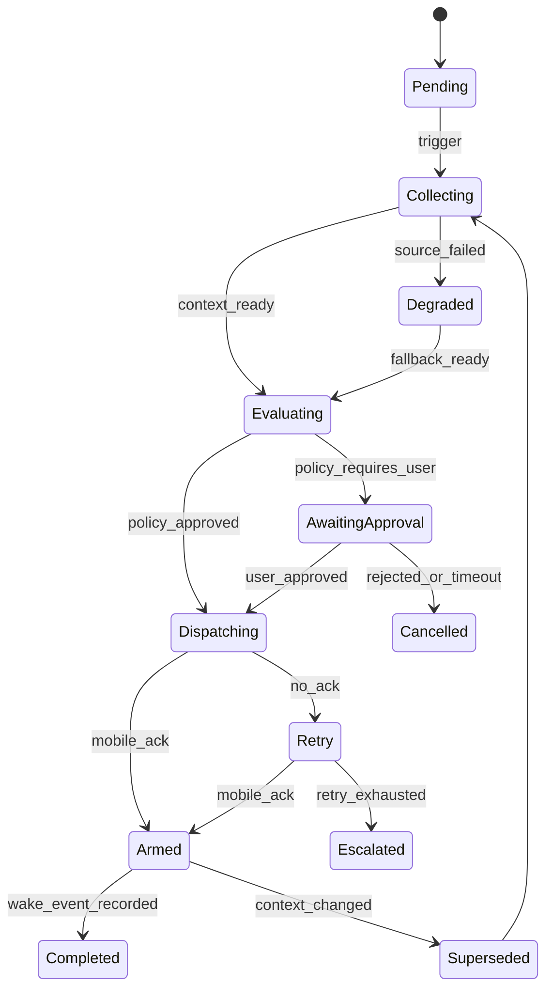
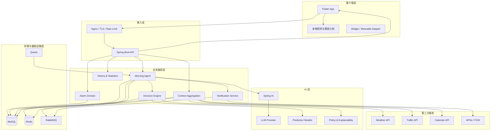
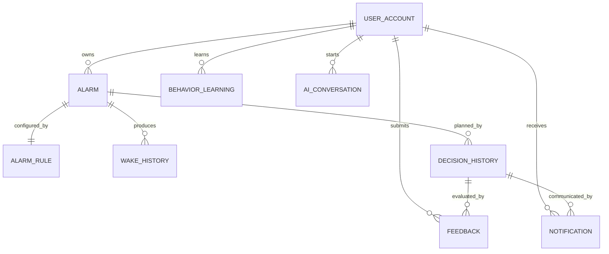
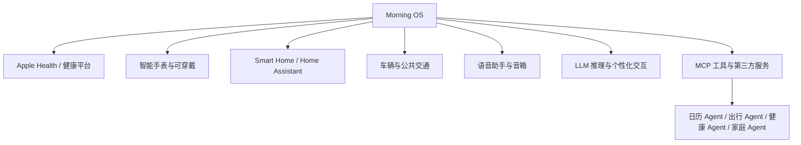

# 知晨（WakeWise）

> **AI Morning Assistant — 产品需求文档与软件架构设计**

**让每一次起床，都恰到好处。**  
*Wake up at the right time, not just on time.*

| 文档属性 | 内容 |
|---|---|
| 版本 | v1.0.0 |
| 作者 | [Your Name] |
| 日期 | 2026-07-31 |
| 状态 | Product & Architecture Baseline |
| 适用范围 | 产品、设计、研发、测试、答辩、开源协作 |

---

## 文档摘要

WakeWise 不是“根据天气提前几分钟”的闹钟，而是一套面向晨间场景的智能决策系统。它以用户必须抵达的时间为目标，综合天气、实时交通、日历、用户行为和历史履约数据，在睡眠收益与迟到风险之间寻找更优平衡，并将决策以可理解、可撤销、可追溯的方式交付给用户。

本版本采用 **AI Morning Assistant** 作为产品定位，以 **Morning OS** 作为长期愿景。工程上采用“确定性决策引擎负责关键时间、LLM 负责理解与交互、本地闹钟负责最终执行”的分层设计，避免生成式模型直接控制高风险动作。

### 产品边界

- WakeWise 提供晨间计划建议和闹钟调度，不提供医疗诊断或睡眠疾病治疗。
- 未经用户授权，不读取日历、位置、健康或家庭设备数据。
- 自动调整始终受用户设置的最早/最晚时间、最大调整幅度和安全规则约束。
- 大模型输出不能绕过决策引擎、权限系统或本地闹钟安全策略。

---

# 第 1 章 品牌设计

## 1.1 品牌故事

传统闹钟只知道一个时间点，却不知道用户为什么要在这个时间醒来。雨雪会拉长通勤，临时会议会改变出门计划，睡眠不足会降低晨间执行力，而固定闹钟对这些变化一无所知。

“知晨”取意于“理解清晨”。WakeWise 希望在用户入睡后继续观察次日环境，在不打扰睡眠的前提下完成信息收集、风险判断和计划更新，让起床从机械提醒变成一次有依据的晨间决策。

## 1.2 品牌哲学

时间不是唯一变量，准时也不是唯一目标。好的晨间体验应同时考虑：睡眠是否充分、起床是否必要、计划是否可执行、风险是否透明、用户是否保有控制权。

## 1.3 愿景、使命与价值观

| 项目 | 定义 |
|---|---|
| 品牌愿景 | 成为用户每天早晨第一个可信赖的 AI 助手，并逐步演进为 Morning OS。 |
| 产品使命 | 帮助用户在“正确的时间”醒来，而不仅是在“设定的时间”响铃。 |
| 核心价值 | 可信、克制、主动、个性化、可解释。 |
| 价值承诺 | 每次调整有依据、每个动作有边界、每次反馈都让系统更懂用户。 |

## 1.4 品牌关键词

`Aware` 环境感知 · `Adaptive` 动态适应 · `Reliable` 可靠执行 · `Explainable` 透明解释 · `Calm` 克制陪伴

## 1.5 品牌人格

WakeWise 像一位可靠、冷静且有分寸的晨间管家：提前处理复杂信息，但不制造焦虑；主动提出建议，但不夺走控制权；表达简洁明确，不用夸张的“AI 魔法”掩盖不确定性。

---

# 第 2 章 产品概览

## 2.1 背景

用户的晨间目标通常不是“7:00 起床”，而是“8:45 前状态良好地到达公司”“不要错过第一节课”或“在航班值机结束前到达机场”。固定闹钟把一个动态规划问题压缩成静态时间点，使天气、交通、日程变化和个人执行差异都留给用户睡前手工处理。

## 2.2 核心痛点

| 痛点 | 现状 | 用户代价 |
|---|---|---|
| 信息割裂 | 天气、路况、日历分散在多个应用 | 睡前重复查询和心算 |
| 静态提醒 | 闹钟不理解到达目标与环境变化 | 恶劣天气或拥堵时迟到 |
| 估算粗糙 | 用户凭经验猜测提前量 | 过早起床或预留不足 |
| 缺乏学习 | 每天重新设置，系统不吸收反馈 | 长期使用价值不增长 |
| 黑盒调整 | 智能产品只给结果，不说明原因 | 用户不敢开启自动执行 |
| 执行脆弱 | 服务端推送受网络和系统限制 | 关键闹钟存在漏响风险 |

## 2.3 为什么传统闹钟已经落后

传统闹钟优化的是“在某一时刻发出声音”。现代晨间需求优化的是“在约束条件下按时完成下一项重要活动”。前者是计时工具，后者是包含信息感知、概率预测、风险控制和行为反馈的决策问题。

## 2.4 为什么需要 AI

AI 的价值不是给闹钟加一个聊天框，而是处理四类传统规则难以稳定覆盖的问题：

1. **语义理解**：从“明天九点客户评审，得提前到”中识别事件重要性和到达约束。
2. **多源推理**：融合天气、路线、日历、个人准备时长等异构信息。
3. **个体校准**：从实际醒来、贪睡、出门和到达结果中学习个人偏差。
4. **自然解释**：把模型结果转化为简短、可核验、可操作的决策说明。

## 2.5 产品定义与定位

> **WakeWise 是一个 AI Morning Assistant。它围绕用户的晨间目标持续感知环境、评估风险、优化唤醒计划，并通过可靠闹钟和晨间简报帮助用户完成从睡眠到出发的转换。**

它不是天气应用的附属闹钟，也不是以聊天为核心的通用助手。

## 2.6 目标用户

### 核心用户

- 有明确到达时间、通勤波动较大的城市职场人。
- 课程安排变化频繁、容易贪睡的高校学生。
- 需要赶早班机、高铁、考试或重要预约的高时效用户。

### 次级用户

- 轮班工作者、跨城通勤者、需要照顾家庭晨间安排的用户。
- 希望联动智能灯、窗帘、音箱和可穿戴设备的智能家居用户。

### 非目标场景

- 医疗级睡眠监测与治疗。
- 无授权的持续定位或员工考勤监控。
- 对秒级准点和生命安全有硬性要求的专业系统。

## 2.7 北极星指标与护栏指标

| 类型 | 指标 | 定义 |
|---|---|---|
| 北极星指标 | 晨间计划成功率 | 用户在目标时间前完成起床/出发/到达目标的有效计划占比 |
| 核心指标 | 智能计划采纳率 | 用户保留系统建议且未撤销的比例 |
| 核心指标 | 迟到风险下降幅度 | 开启 WakeWise 前后可比晨间任务的迟到率变化 |
| 学习指标 | 个体误差 MAE | 预测准备时长与实际准备时长的平均绝对误差 |
| 信任指标 | 解释有用率 | 用户认为调整原因清楚且有帮助的比例 |
| 护栏指标 | 无效早起时长 | 因过度保守导致的额外早起分钟数 |
| 护栏指标 | 关键闹钟执行成功率 | 本地计划实际触发的比例，目标不低于 99.99% |

---

# 第 3 章 市场分析

> 本章比较产品的公开定位与典型能力。具体功能会随地区、系统版本和厂商策略变化，正式立项前应进行当期实机复核。

## 3.1 竞品矩阵

| 产品/类型 | 核心优势 | 主要局限 | 对 WakeWise 的启示 |
|---|---|---|---|
| Alarmy | 强制起床任务、唤醒成功机制成熟 | 更关注“必须醒”，弱于环境与行程决策 | 强唤醒可作为执行层，而非产品全部价值 |
| Google Clock | Android 原生整合、稳定、简洁 | 以固定闹钟和系统体验为主 | 基础闹钟可靠性必须达到系统级预期 |
| Apple Clock | 系统权限与硬件协同、用户覆盖广 | 个性化通勤决策有限，生态相对封闭 | 本地调度、健康与设备协同是长期壁垒 |
| Sleep Cycle | 睡眠阶段分析和柔性唤醒体验 | 对日程、交通和到达风险覆盖不足 | 生理状态应成为决策输入，但需谨慎声明准确性 |
| 华为时钟/健康生态 | 手机、手表、健康和设备协同 | 智能能力受设备生态与系统版本限制 | 多设备触达能提升可靠性与数据完整度 |
| 小米时钟/小爱生态 | 智能家居联动和语音入口丰富 | 核心闹钟通常仍由规则和用户设置驱动 | Morning Routine 可以跨越手机、音箱和家居 |
| 天气闹钟类应用 | 概念直观、功能轻量、易于上手 | 常停留在“下雨提前 N 分钟”，学习和解释弱 | 仅靠天气规则难以形成持续价值与信任 |

## 3.2 市场机会

现有市场被拆成四块：系统闹钟负责可靠触发，天气应用负责环境信息，地图负责 ETA，日历负责日程，睡眠应用负责生理信号。WakeWise 的机会不在替代这些基础设施，而在建立一个以“晨间目标履约”为中心的决策层。

## 3.3 竞争优势

1. **目标驱动**：从“几点响”升级为“为了什么、最晚何时完成”。
2. **多源风险模型**：使用概率分布和置信度，而非简单天气加权。
3. **个体数字画像**：持续校准起床延迟、准备时间和通勤偏差。
4. **解释与控制**：展示关键因素、置信度、调整幅度和撤销入口。
5. **可靠执行**：服务端规划、本地闹钟执行、推送与设备协同兜底。
6. **Morning Agent**：将感知、决策、执行、反馈组织成可审计的闭环。

## 3.4 差异化壁垒

单一模型或 API 不是长期壁垒。真正的复合壁垒来自：高质量个人行为序列、晨间任务结果标签、跨数据源的决策评估体系、用户信任机制，以及长期积累的多设备执行能力。

---

# 第 4 章 产品哲学



“准点响铃”只验证系统有没有在设定时刻工作；“恰当起床”则验证用户是否以合理的睡眠成本完成晨间目标。WakeWise 不一味追求更早，而是优化以下目标：

- 将重要事件的迟到风险控制在用户可接受范围内。
- 在满足风险约束的候选方案中，尽可能保留睡眠时间。
- 避免频繁、剧烈、无法解释的计划变化。
- 当数据置信度不足时采用保守策略并明确告知用户。

因此，最佳唤醒时间不是一个绝对正确的点，而是在用户偏好、环境不确定性和执行风险之间得到的“最佳可行解”。

---

# 第 5 章 用户研究

## 5.1 Persona

| Persona | 场景与目标 | 当前行为 | 核心障碍 | 产品机会 |
|---|---|---|---|---|
| 林悦，28 岁，产品经理 | 9:30 前到公司，公交通勤波动大 | 睡前查天气和地图，手动改闹钟 | 忘记检查；预估不稳定 | 自动读取首个日程并给出可撤销调整 |
| 陈浩，20 岁，本科生 | 不错过早八课程 | 设置多个闹钟并反复贪睡 | 课程表变化；缺乏起床动机 | 课程表接入、任务唤醒、到课反馈 |
| 周敏，35 岁，商务顾问 | 赶航班、客户会议等重要任务 | 同时使用日历、地图、航空应用 | 风险高，宁愿少睡也不能迟到 | 事件级风险偏好与多阶段提醒 |

## 5.2 端到端用户旅程

| 阶段 | 用户行为 | 情绪/痛点 | WakeWise 介入 |
|---|---|---|---|
| 晚间计划 | 查看明日日程，设置闹钟 | 信息分散、容易漏项 | 自动识别首个关键事件，生成晨间计划 |
| 入睡前 | 担心天气和交通变化 | 不确定、反复确认 | 提供简短计划卡片和调整原因 |
| 夜间 | 用户睡眠 | 不希望被打扰 | Agent 静默复核，只有重大变化才通知 |
| 唤醒 | 关闭或贪睡 | 意识模糊、决策能力低 | 渐进唤醒、下一步提示、必要时升级强度 |
| 准备/出发 | 洗漱、穿衣、通勤 | 容易拖延 | 节点提醒、天气与路线简报 |
| 事后 | 到达目的地 | 不愿填写复杂问卷 | 轻量确认或自动推断，更新个人模型 |

## 5.3 典型场景

### 场景 A：暴雨与早会

系统发现次日 9:00 有高重要性线下会议，暴雨使公交 ETA 的 P90 增加 18 分钟。WakeWise 在用户允许的范围内将闹钟提前 15 分钟，并说明“交通风险是主因，天气为次因”，用户可一键恢复原计划。

### 场景 B：晴天多睡一会儿

道路畅通且用户过去两周的晨间准备时间比初始设置短 8 分钟。系统建议延后 5 分钟，但仅在用户开启“允许延后”且事件风险较低时自动执行。

### 场景 C：临时线上会议

日历地点从公司变为线上，系统取消通勤时间，仅保留起床和准备时长。计划变化超过阈值时，系统请求用户确认，而不是直接延后 40 分钟。

### 场景 D：数据不可用

交通 API 失败。系统使用同路线历史分位值和安全余量计算，明确标记低置信度，并保留先前已下发至设备的闹钟。

## 5.4 机会优先级

| 机会 | 用户价值 | 实现成本 | 优先级 |
|---|---:|---:|---:|
| 日历 + 天气 + 路况联合计划 | 高 | 中 | P0 |
| 可解释调整与一键撤销 | 高 | 低 | P0 |
| 本地闹钟可靠调度 | 极高 | 中 | P0 |
| 行为学习与个体校准 | 高 | 中 | P1 |
| 可穿戴与智能家居联动 | 中高 | 高 | P2 |
| Agent 网络与第三方技能市场 | 中 | 极高 | P3 |

---

# 第 6 章 产品功能设计

## 6.1 功能地图



## 6.2 闹钟中心

| 维度 | 设计 |
|---|---|
| 目的 | 管理固定闹钟、目标到达型闹钟和一次性重要事件闹钟。 |
| 核心功能 | 周期规则、目标到达时间、准备时长、最大调整范围、贪睡策略、本地兜底、临时停用。 |
| 工作流 | 创建目标 → 设置边界 → 生成基准计划 → AI 调整 → 用户确认/撤销 → 本地调度。 |
| 未来扩展 | 睡眠阶段柔性窗口、多设备协同响铃、家庭成员晨间计划。 |

## 6.3 天气中心

| 维度 | 设计 |
|---|---|
| 目的 | 提供与晨间窗口相关的天气风险，而不是复制完整天气应用。 |
| 核心功能 | 小时级天气、分钟级降水、预警、体感温度、能见度、空气质量、数据源置信度。 |
| 工作流 | 定位授权 → 多源获取 → 标准化 → 质量评分 → 缓存 → 决策引擎消费。 |
| 未来扩展 | 微气候、校园/园区传感器、穿衣与携带物品建议。 |

## 6.4 交通中心

| 维度 | 设计 |
|---|---|
| 目的 | 估计不同出发时间与交通方式下的通勤时间分布。 |
| 核心功能 | 常用地点、路线偏好、实时 ETA、历史波动、异常事件、替代路线。 |
| 工作流 | 读取事件地点 → 计算候选路线 → 获取实时/预测 ETA → 生成 P50/P90 → 输出风险。 |
| 未来扩展 | 公交到站、停车时间、车辆预热、跨城行程联动。 |

## 6.5 日历中心

| 维度 | 设计 |
|---|---|
| 目的 | 将日程转换成可计算的晨间目标与约束。 |
| 核心功能 | 系统日历授权、事件地点、线上/线下识别、重要性、准备要求、冲突提示。 |
| 工作流 | 同步事件 → 结构化解析 → 选择首个关键事件 → 请求缺失信息 → 建立到达约束。 |
| 未来扩展 | 邮件/票务解析、课程表、企业排班、家庭共享日历。 |

## 6.6 AI 决策中心

| 维度 | 设计 |
|---|---|
| 目的 | 在风险约束下计算最佳可行唤醒计划。 |
| 核心功能 | 特征融合、概率预测、策略求解、置信度、决策解释、模拟对比、版本追踪。 |
| 工作流 | 构建上下文 → 校验数据 → 估计耗时分布 → 评估候选时间 → 选择计划 → 生成解释。 |
| 未来扩展 | 因果评估、端侧模型、群体先验、联邦学习。 |

## 6.7 Morning Agent

| 维度 | 设计 |
|---|---|
| 目的 | 自主编排感知、决策、执行、通知和复盘任务。 |
| 核心功能 | 定时触发、工具调用、状态机、失败重试、人工确认、审计日志。 |
| 工作流 | 触发 → 制定任务 → 调用工具 → 决策 → 执行边界检查 → 下发 → 复盘。 |
| 未来扩展 | MCP 工具接入、多 Agent 协作、家庭/车辆 Agent。 |

## 6.8 统计中心

| 维度 | 设计 |
|---|---|
| 目的 | 让用户看见系统是否真正减少迟到并改善晨间体验。 |
| 核心功能 | 准时率、平均调整量、额外睡眠、贪睡趋势、预测误差、主要风险来源。 |
| 工作流 | 汇总历史 → 匿名化计算 → 周报/月报 → 提供可执行建议。 |
| 未来扩展 | 目标管理、团队匿名洞察、健康趋势关联。 |

## 6.9 设置与隐私

| 维度 | 设计 |
|---|---|
| 目的 | 将自动化边界、数据权限和安全选项交还用户。 |
| 核心功能 | 自动化等级、最大提前/延后、风险偏好、数据授权、保留周期、导出/删除账户。 |
| 工作流 | 分层授权 → 即时生效 → 权限变化触发能力降级 → 展示影响。 |
| 未来扩展 | 家庭策略、企业合规策略、端侧隐私计算。 |

## 6.10 自动化等级

| 等级 | 行为 | 适用阶段 |
|---|---|---|
| L0 仅观察 | 只展示建议，不改变闹钟 | 新用户建立信任 |
| L1 需确认 | 每次调整均需确认 | 重要事件或低置信度 |
| L2 边界内自动 | 在用户设定范围内自动调整 | 默认推荐 |
| L3 全流程协同 | 联动家居、穿戴和交通工具 | 成熟用户与未来版本 |

---

# 第 7 章 AI 能力设计

## 7.1 AI 分层



## 7.2 环境感知

环境感知层把不同供应商数据标准化为统一的 `MorningContext`：时间窗口、地理网格、天气风险、路线 ETA 分位数、日历约束、设备状态和数据新鲜度。每项数据附带来源、采集时间和质量评分，禁止把过期或冲突数据当作确定事实。

## 7.3 用户建模

用户画像分为三层：

- **显式偏好**：风险容忍度、准备时间、交通方式、自动化等级、禁止调整区间。
- **稳定特征**：工作日节奏、平均起床延迟、常用地点、典型路线。
- **动态状态**：近期睡眠、连续贪睡、临时日程、设备电量、最近反馈。

敏感特征只在明确授权和必要目的下使用。用户可查看、纠正和删除画像数据。

## 7.4 行为学习

系统学习的对象不是“用户喜欢几点起”，而是多个可验证的时间分布：

- 从响铃到真正离床的 `wake_latency`。
- 从离床到出门的 `prep_duration`。
- 从出发到到达的 `travel_duration`。
- 对不同唤醒方式的响应概率。
- 建议被接受、撤销或手动修改的偏好信号。

早期使用群体先验与用户显式设置；样本积累后采用指数衰减更新或分层贝叶斯校准，避免少量异常日把模型带偏。

## 7.5 决策引擎

决策引擎由硬约束、预测模型和策略优化器组成。它输出结构化的 `WakePlan`，包含推荐时间、备选时间、迟到概率、调整原因、置信度、数据版本和执行边界。LLM 无权直接写入最终闹钟时间。

## 7.6 风险评估

系统同时评估：迟到风险、过早唤醒成本、计划变化成本、数据缺失风险和执行失败风险。重要日程使用更高分位的耗时估计；普通日程则更重视睡眠收益。极端天气预警、交通中断和权限缺失触发规则覆盖或人工确认。

## 7.7 可解释 AI

每次调整至少回答四个问题：

1. 调整了多少分钟？
2. 哪些因素贡献最大？
3. 当前预测有多可靠？
4. 用户可以如何修改或撤销？

示例：

> 明早闹钟已从 07:00 调整为 06:45。8:30 的线下评审需要提前到场；预计降雨使公交行程 P90 增加 11 分钟，你最近两周平均准备时间比设置值多 4 分钟。当前置信度 82%，可一键恢复 07:00。

解释只引用决策记录中的事实，不允许 LLM 编造天气、路况或统计数字。

## 7.8 推荐引擎

推荐对象包括唤醒时间、唤醒策略、出发时间、路线和晨间准备建议。排序目标综合任务成功概率、睡眠保留、用户偏好和打扰成本。对可能显著改变睡眠或行程的建议默认不做静默执行。

## 7.9 持续学习闭环



模型更新采用离线评估、影子模式、灰度发布和版本回滚。衡量“越来越聪明”的标准是预测误差和迟到风险下降，而不是模型参数越来越多。

## 7.10 冷启动与失效保护

- 第 1～7 天以用户显式设置和同类场景先验为主，只做小幅建议。
- 样本不足时不展示虚假精确度，置信度标记为“较低”。
- API 失败时优先沿用已下发计划，其次使用缓存和历史保守估计。
- 决策服务不可用时，本地固定闹钟仍照常响铃。

---

# 第 8 章 Morning Agent 设计

## 8.1 Agent 职责

Morning Agent 是一个受策略约束的自主任务编排器。它负责决定“下一步调用哪个工具”，但不能突破权限、时间边界或执行策略。Agent 不是单一 LLM 对话，而是可恢复、可审计的状态机。

## 8.2 夜间计划示例



## 8.3 Agent 组件

| 组件 | 职责 |
|---|---|
| Trigger Manager | 管理 22:00 计划、临睡前复核、闹钟前复核和事件变更触发。 |
| Context Builder | 汇总工具结果，处理过期、冲突和缺失数据。 |
| Tool Registry | 暴露天气、交通、日历、用户画像、通知等受控工具。 |
| Planner | 根据任务类型决定调用顺序，可由规则和 LLM 协同。 |
| Decision Engine | 以确定性接口计算候选时间和风险。 |
| Policy Guard | 校验授权、自动化等级、最大调整和敏感操作。 |
| Executor | 下发移动端计划、发送通知、安排复核任务。 |
| Memory | 保存短期任务状态和长期行为摘要，不保存无关对话。 |
| Audit & Observability | 记录输入版本、工具调用、决策、错误和人工覆盖。 |

## 8.4 Agent 状态机



## 8.5 工具调用契约

每个工具声明输入模式、输出模式、超时、幂等键、权限范围和数据新鲜度。所有外部内容视为不可信数据，不能作为系统指令执行，以抵御提示注入。MCP 接入沿用相同策略，通过 allowlist 暴露只读或有限写入能力。

## 8.6 可靠性策略

- 服务端计算完成后，必须获得移动端本地调度 ACK 才进入 `ARMED`。
- 相同 `planId` 重复下发必须幂等。
- 新计划未成功落地前不得取消旧计划。
- 距响铃不足安全窗口时，禁止无确认地大幅延后。
- 推送用于告知和补偿，不作为唯一响铃机制。
- 连续失败进入人工可见的降级状态，并保留固定闹钟。

---

# 第 9 章 产品工作流

## 9.1 夜间工作流

```text
日程或固定规则确定晨间目标
        ↓
22:00 汇总天气 / 路况 / 日历 / 行为画像
        ↓
检查数据时效、冲突与缺失
        ↓
计算候选计划和迟到风险
        ↓
策略守卫判断：自动执行 / 请求确认 / 保持原计划
        ↓
下发移动端本地闹钟并等待 ACK
        ↓
生成可解释通知并安排二次复核
```

## 9.2 晨间工作流

```text
本地闹钟触发 → 渐进唤醒 → 用户关闭/贪睡
                         ↓
                   记录响应行为
                         ↓
天气 + 行程 + 下一步行动简报 → 出门节点提醒 → 到达结果
```

## 9.3 通知工作流

```text
计划变化 → 判断重要程度
    ├─ 小幅且边界内 → 静默更新 + 摘要通知
    ├─ 大幅或低置信度 → 交互式确认通知
    └─ 极端风险 → 高优先级预警 + 保留安全闹钟
```

## 9.4 学习工作流

```text
采集最小必要事件 → 推断起床/出门/到达时间 → 异常值处理
→ 计算预测偏差 → 更新个人参数 → 离线评估 → 灰度生效
```

## 9.5 反馈工作流

```text
“太早 / 正合适 / 太晚 / 原因不对”
        ↓
映射为时间偏差与偏好标签
        ↓
调整用户参数，而非立即重训全局模型
        ↓
后续相似场景验证改善效果
```

---

# 第 10 章 技术架构与选型

## 10.1 架构原则

- MVP 采用模块化单体，避免过早拆微服务；按领域保留清晰边界。
- 关键链路确定性优先，LLM 不直接控制闹钟执行。
- 本地优先保证响铃，云端负责更聪明的计划。
- 所有外部数据均可失败，系统必须可降级。
- 敏感数据最小化采集，授权可撤回，决策可审计。

## 10.2 技术选型

| 技术 | 用途 | 选择理由 | 使用边界 |
|---|---|---|---|
| Flutter | iOS/Android 客户端 | 跨端一致、开发效率高、适合统一交互 | 闹钟调度需分别封装 iOS/Android 原生能力 |
| Spring Boot / Java 21 | 核心后端 | 类型安全、生态成熟、监控与任务体系完善 | 初期采用模块化单体，不盲目微服务化 |
| Spring AI | 生产 AI 接入主框架 | 与 Spring 生态一致，便于模型切换、工具调用和可观测 | 只承担语义与编排层，不替代决策引擎 |
| LangChain4j | 备选 AI 框架与实验验证 | Java 原生 Agent/RAG API 友好，适合技术对比 | MVP 不与 Spring AI 重复承载同一链路 |
| Redis | 热数据、锁、限流、短期状态 | 低延迟，适合天气缓存和 Agent 状态 | 不作为决策历史的唯一持久化 |
| MySQL 8 | 事务数据与审计记录 | 成熟稳定，关系模型和索引能力适合核心业务 | 大规模时序分析后期进入专用数仓 |
| RabbitMQ | 异步事件与重试 | 路由、确认、死信机制成熟 | 关键闹钟不能仅依赖消息队列 |
| Quartz | 夜间计划与复核调度 | 支持持久化、集群与复杂触发规则 | 大规模任务需分片和防重复执行 |
| Docker | 环境一致性与部署 | 便于本地开发、CI 和云部署 | 移动端构建独立处理 |
| Nginx | TLS 终止与反向代理 | 稳定、轻量、限流和静态资源能力成熟 | 复杂 API 治理成熟后可引入专用网关 |
| Weather API | 天气与预警 | 获得小时级环境数据 | 多源校验、缓存、遵守供应商许可 |
| Traffic API | 路线与 ETA | 提供实时/预测通勤数据 | 记录置信区间，避免把单点 ETA 当事实 |
| Calendar API | 日程约束 | 将事件转换为晨间目标 | 最小权限、优先端侧解析 |
| APNs / FCM / 厂商推送 | 通知与补偿触达 | 覆盖主流系统渠道 | 不作为唯一闹钟触发渠道 |

## 10.3 Spring AI 与 LangChain4j 决策

生产基线选择 Spring AI，与 Spring Boot 的配置、依赖注入、监控和安全体系保持一致。LangChain4j 用于技术验证或未来适配，不在 MVP 同时引入两套 Agent 抽象，避免重复依赖、观测割裂和行为不一致。如未来确需切换，只在 `AiInteractionPort` 边界实现新的适配器。

---

# 第 11 章 系统架构

## 11.1 逻辑架构



## 11.2 部署演进

MVP 将业务模块部署为一个 Spring Boot 应用，MySQL、Redis、RabbitMQ 独立容器运行。随着任务量增长，优先拆分 `context-worker`、`decision-worker` 和 `notification-worker`，而不是按表或 CRUD 模块机械拆分。

## 11.3 缓存设计

- 天气按地理网格和小时缓存，TTL 由预报窗口决定。
- 路况按路线、交通方式和出发时间桶缓存，短 TTL 并保留采集时间。
- Agent 运行状态存 Redis，最终审计写入 MySQL。
- 缓存击穿使用请求合并和分布式锁；过期数据只能作为明确标记的降级输入。

## 11.4 安全与隐私

- OAuth 2.1/OIDC 登录，访问令牌短时有效，刷新令牌轮换。
- 日历、位置、健康数据采用分目的授权和最小权限。
- TLS 传输加密；敏感字段列级加密；密钥进入 KMS/Secret Manager。
- 高风险操作要求设备绑定、签名计划和幂等校验。
- 审计日志不记录原始令牌、完整地址或不必要的日历正文。
- 支持数据导出、撤销授权、账户删除和保留周期配置。

## 11.5 高可用与容灾

| 风险 | 设计 |
|---|---|
| 后端不可用 | 客户端保留最近有效计划和固定闹钟 |
| 外部 API 不可用 | 缓存 + 历史分位值 + 低置信度标记 |
| MQ 消息重复 | 业务幂等键、消费确认、唯一约束 |
| 推送失败 | 多渠道重试，但本地闹钟不受影响 |
| 任务重复执行 | Quartz 集群锁 + planId 幂等 |
| 新计划下发失败 | 不取消旧计划，告警并降级 |

## 11.6 可观测性

核心指标包括计划计算延迟、外部 API 成功率、移动端 ACK 率、本地触发率、自动调整率、撤销率和预测误差。日志以 `traceId/userPseudoId/planId` 串联，决策模型、规则和提示词均版本化。

---

# 第 12 章 数据库设计

详细字段、索引、DDL 建议与数据字典见《WakeWise-数据库设计.md》。本章给出领域关系与核心表摘要。

## 12.1 核心表

| 表 | 作用 | 关键字段 |
|---|---|---|
| `user_account` | 用户身份、时区和状态 | `id`, `email`, `timezone`, `status` |
| `alarm` | 一个具体晨间目标或闹钟 | `id`, `user_id`, `target_type`, `target_time`, `enabled` |
| `alarm_rule` | 周期、调整边界和风险偏好 | `alarm_id`, `rrule`, `max_advance_min`, `automation_level` |
| `weather_cache` | 标准化天气快照 | `geo_hash`, `forecast_time`, `payload`, `quality_score` |
| `traffic_cache` | 路线 ETA 与分位值 | `route_key`, `departure_bucket`, `eta_p50_sec`, `eta_p90_sec` |
| `wake_history` | 实际响铃、离床、出门、到达事件 | `alarm_id`, `scheduled_at`, `woke_at`, `departed_at`, `arrived_at` |
| `decision_history` | 每次决策输入、结果和版本 | `plan_id`, `recommended_at`, `risk_score`, `confidence`, `model_version` |
| `behavior_learning` | 用户行为参数与样本统计 | `user_id`, `feature_key`, `estimate`, `sample_count` |
| `notification` | 通知发送与交互状态 | `user_id`, `type`, `channel`, `status`, `sent_at` |
| `feedback` | 用户对计划和解释的反馈 | `decision_id`, `rating`, `reason_code`, `comment` |
| `ai_conversation` | 经最小化处理的助手会话 | `user_id`, `session_id`, `content_json`, `retention_until` |

## 12.2 ER 关系



天气和交通缓存属于共享上下文，不直接以外键绑定用户；决策历史只保存使用到的快照引用或经过最小化的特征摘要，以减少位置数据冗余。

---

# 第 13 章 核心算法

## 13.1 从加权规则到风险约束优化

简单的“天气分数 × 提前量”无法处理因素相关性、数据不确定性和睡眠成本。WakeWise 采用两阶段模型：先预测时间分布，再在约束内优化唤醒计划。

设目标到达时间为 `D`：

```text
RequiredTime = WakeLatency + PreparationTime + TravelTime + SafetyBuffer
CandidateWakeTime = D - Quantile(RequiredTime, q)
```

其中 `q` 由事件重要性和用户风险偏好决定，例如普通日程使用 P75，重要航班可使用 P95。

## 13.2 五类特征得分

| 得分 | 范围 | 关键输入 | 作用 |
|---|---:|---|---|
| Environment Score `E` | 0～100 | 降水、体感温度、能见度、风、AQI、预警 | 影响准备与路线的不确定性 |
| Traffic Score `T` | 0～100 | ETA P50/P90、事故、公共交通延误、路线稳定性 | 估计通勤时长与尾部风险 |
| Behavior Score `B` | 0～100 | 贪睡率、起床延迟、准备时长偏差、近期趋势 | 校准个人执行能力 |
| Calendar Score `C` | 0～100 | 事件重要性、地点、签到要求、缓冲需求 | 决定迟到损失和风险阈值 |
| Season Score `S` | 0～100 | 日出、季节、节假日、长期周期 | 提供稳定背景修正，不覆盖实时信号 |

这些分数用于解释和特征监控，而不是直接线性相加得到提前分钟数。预测模型使用原始特征与交叉项估计各阶段耗时分布。

## 13.3 风险分数

```text
P_late(t) = P(t + WakeLatency + PreparationTime + TravelTime > D)

RiskScore(t) = 100 × [
    P_late(t) × EventCost
  + DataUncertainty × UncertaintyPenalty
  + ExecutionRisk × ReliabilityPenalty
]
```

所有项归一化到 `[0,1]`。`EventCost` 由日程重要性和用户设置共同决定，不能仅由 LLM 推断。

## 13.4 最佳时间求解

对允许窗口内每个候选时间 `t` 计算：

```text
Utility(t) =
    λ1 × ExpectedLateCost(t)
  + λ2 × SleepLoss(t)
  + λ3 × PlanChangeCost(t)
  + λ4 × LowConfidencePenalty(t)

t* = argmin Utility(t)
```

同时满足：

- `baseline - maxAdvance ≤ t ≤ baseline + maxDelay`
- 不晚于用户设置的最晚起床时间。
- 延后计划必须开启相应权限。
- 重大变化或低置信度必须请求确认。
- 不得低于系统和设备的安全调度窗口。

## 13.5 示例

目标 08:45 到达；预测起床延迟 P90 为 8 分钟、准备时长 P90 为 34 分钟、通勤 P90 为 47 分钟、安全余量 6 分钟，则候选起床时间为 07:10。若基准闹钟为 07:20 且最大提前量为 20 分钟，系统建议提前 10 分钟。解释展示主要增量来自交通尾部风险，而不是笼统归因于“天气不好”。

## 13.6 模型演进

| 阶段 | 方法 | 适用条件 |
|---|---|---|
| MVP | 规则 + 分位统计 + 用户显式参数 | 数据稀疏、强调可解释性 |
| V1 | 梯度提升树/分位回归 | 有稳定特征和结果标签 |
| V2 | 分层个性化与在线校准 | 单用户样本逐步积累 |
| V3 | 因果评估与端侧轻量模型 | 需要判断“提前是否真正改善结果” |

---

# 第 14 章 API 设计

详细接口契约见《WakeWise-API设计.md》。API 采用 `/api/v1` 版本前缀、JSON、UTC ISO 8601 时间以及 OAuth 2.1 Bearer Token。

## 14.1 核心资源

| 方法 | 路径 | 说明 |
|---|---|---|
| `POST` | `/api/v1/alarms` | 创建晨间目标/闹钟 |
| `GET` | `/api/v1/alarms` | 查询闹钟列表 |
| `PATCH` | `/api/v1/alarms/{id}` | 修改状态或配置 |
| `POST` | `/api/v1/alarms/{id}/preview` | 预览候选计划，不执行 |
| `POST` | `/api/v1/decisions/evaluate` | 计算决策结果 |
| `GET` | `/api/v1/decisions/{planId}` | 查询解释、风险和状态 |
| `POST` | `/api/v1/decisions/{planId}/confirm` | 确认计划 |
| `POST` | `/api/v1/decisions/{planId}/revert` | 撤销至先前计划 |
| `POST` | `/api/v1/device-plans/{planId}/ack` | 客户端确认本地调度成功 |
| `GET` | `/api/v1/morning/context` | 获取晨间简报 |
| `POST` | `/api/v1/feedback` | 提交轻量反馈 |
| `GET` | `/api/v1/statistics/weekly` | 获取周度洞察 |

## 14.2 统一响应

```json
{
  "success": true,
  "data": {},
  "traceId": "01K1...",
  "timestamp": "2026-07-31T14:00:00Z"
}
```

错误响应：

```json
{
  "success": false,
  "error": {
    "code": "DECISION_LOW_CONFIDENCE",
    "message": "当前交通数据不足，需要用户确认",
    "details": { "missingSources": ["traffic"] }
  },
  "traceId": "01K1...",
  "timestamp": "2026-07-31T14:00:00Z"
}
```

## 14.3 API 原则

- 写操作支持 `Idempotency-Key`。
- 使用游标分页，避免深分页。
- `planId` 和 `version` 防止旧计划覆盖新计划。
- 对外部展示的原因码稳定，内部模型字段不直接暴露。
- 删除账户与撤回授权属于高风险操作，需要二次验证。

---

# 第 15 章 UI/UX 设计

## 15.1 设计原则

- 首页先回答“明早几点起、为什么、是否可靠”，不堆砌仪表盘。
- 用分钟和自然语言表达影响，避免向普通用户暴露模型术语。
- 自动化动作必须有状态、来源、撤销和失败反馈。
- 晨间弱认知状态下使用大目标、少选项、高对比和短文案。

## 15.2 页面设计

| 页面 | 核心内容 | 关键交互 |
|---|---|---|
| 首页 | 下次唤醒、目标事件、调整幅度、主因、置信度、晨间摘要 | 展开解释、确认/撤销、临时暂停 |
| 闹钟 | 固定/目标型闹钟列表、周期、边界、自动化等级 | 新建、复制、滑动启停、预览下一次计划 |
| 分析 | 因素贡献、候选方案、迟到风险、数据新鲜度 | 比较“原计划/推荐计划”，调整风险偏好 |
| 历史 | 时间线形式的计划、变更、响铃与反馈 | 筛选、查看决策证据、纠正行为事件 |
| 统计 | 准时率、额外睡眠、平均调整、预测误差 | 周/月切换、洞察卡片、关闭不需要的指标 |
| 设置 | 权限、自动化、通知、唤醒方式、数据管理 | 分层授权、影响说明、导出/删除 |
| 个人资料 | 时区、常用地点、交通方式、晨间准备偏好 | 编辑时即时预估对计划的影响 |
| 通知中心 | 调整、确认、风险预警、系统异常 | 一键确认、撤销、稍后提醒 |
| AI 助手 | 晨间问答、计划修改、解释追问 | “为什么提前？”“明天改成线上”自然语言操作 |

## 15.3 首页信息层级

```text
┌─────────────────────────────┐
│ 明早 06:45                  │  第一视觉焦点
│ 为 08:30 产品评审           │  目标语境
│ 比原计划提前 15 分钟         │  变化
│                              │
│ 暴雨 + 公交通勤 P90 增加 11 分│  主因
│ 置信度 82% · 21:58 更新      │  可信度
│                              │
│ [查看分析]       [恢复 07:00]│  控制权
├─────────────────────────────┤
│ 需要带伞 · 建议 07:32 出门   │  下一步行动
└─────────────────────────────┘
```

## 15.4 关键状态

- **正常计划**：展示下一次闹钟和目标。
- **已智能调整**：突出变化量和原因，不使用制造焦虑的红色。
- **等待确认**：明确截止时间和默认行为。
- **低置信度**：展示缺失数据和保守方案。
- **离线/服务异常**：确认本地闹钟仍有效，避免用户恐慌。
- **空状态**：引导创建第一个“到达目标”，而不是只显示加号。

## 15.5 可访问性

支持动态字体、屏幕阅读器、触觉反馈、色盲安全配色和纯振动模式。关键信息不能只靠颜色传达；晨间操作目标尺寸不小于平台推荐值。

---

# 第 16 章 产品路线图

| 阶段 | 目标 | 新功能 | 技术演进 | 成功门槛 |
|---|---|---|---|---|
| MVP | 验证用户是否接受可解释的动态闹钟 | 目标型闹钟、天气/日历、规则决策、本地兜底、确认/撤销 | Flutter + Spring Boot 模块化单体；MySQL/Redis/Quartz | 关键闹钟成功率 ≥99.99%，建议采纳率达到验证目标 |
| V1 | 完成天气、路况、日历闭环 | 多路线 ETA、分位风险、晨间简报、历史 | RabbitMQ、外部 API 降级、决策审计 | 迟到风险显著下降，无效早起可控 |
| V2 | 建立个性化学习 | 行为校准、周报、唤醒策略推荐 | 特征服务、模型注册、影子评估 | 个体耗时预测 MAE 持续下降 |
| V3 | 扩展到多设备 Morning Routine | 手表、音箱、灯光、窗帘、车辆协同 | 设备编排、事件驱动拆分、端侧推理 | 多设备执行稳定且隐私可控 |
| V4 | 形成 Morning OS 平台 | MCP 工具、第三方 Agent、开放 API、企业/校园方案 | Agent 平台、权限沙箱、开发者门户 | 生态调用增长且核心可靠性不下降 |

每阶段采用能力门槛而非仅按日期升级；可靠性和信任指标未达标时，不开放更高自动化等级。

---

# 第 17 章 商业模式

## 17.1 收入结构

| 模式 | 客户 | 价值 | 可能的收费方式 |
|---|---|---|---|
| 个人订阅 | 通勤者、学生、高频差旅者 | 高级路线、行为学习、多设备、长期洞察 | 月/年订阅 |
| 企业方案 | 企业与园区 | 班车、轮班、匿名通勤风险提醒 | 按席位或组织订阅 |
| 校园方案 | 高校 | 课表、校车、校园天气与活动协同 | 校级授权 |
| API | 出行、日历、健康应用 | 晨间风险评分与计划能力 | 调用量 + SLA |
| AI 服务 | 硬件厂商、应用开发者 | Agent 编排、解释和个性化策略 | 模型调用或能力包 |
| 硬件合作 | 手机、手表、音箱、照明厂商 | 系统级可靠触达和场景联动 | 预装、联合会员、授权 |
| 智能家居 | 家庭自动化平台 | Morning Routine 与设备场景 | 高级场景订阅/渠道分成 |

## 17.2 商业原则

- 基础可靠闹钟、本地兜底和隐私控制不应成为付费墙。
- 不出售精确位置、健康或日历数据。
- 企业版默认只提供聚合洞察，不向雇主暴露个人晨间行为。
- 订阅价值来自持续智能与生态协同，不依赖广告打扰晨间体验。

---

# 第 18 章 项目亮点

1. **AI Agent 闭环**：从定时触发、工具调用、策略判断到执行回执和复盘，具备完整自治链路。
2. **LLM 使用边界清晰**：LLM 负责理解、编排和解释，确定性引擎负责高风险时间决策。
3. **行为学习**：围绕可验证的起床、准备、出发和到达序列持续个体校准。
4. **环境感知**：融合天气、交通、日历、设备和历史数据，并显式管理数据质量。
5. **可解释 AI**：决策保留因素贡献、置信度、版本和原始证据引用。
6. **可靠执行**：云端规划与端侧闹钟分离，ACK、幂等、旧计划保留和多渠道补偿共同兜底。
7. **可扩展架构**：从模块化单体平滑演进到事件驱动服务，避免 MVP 过度设计。
8. **云原生工程**：Docker、Nginx、消息队列、集中观测、灰度与回滚形成生产基线。
9. **MCP-ready**：工具注册、权限范围、输入输出 Schema 和审计天然兼容 MCP 接入。
10. **未来 AI 扩展**：可接入端侧模型、可穿戴信号、家居 Agent 与车辆 Agent，而不破坏核心决策边界。

---

# 第 19 章 未来愿景：Morning OS

WakeWise 的终局不是拥有最多闹钟功能，而是成为个人清晨阶段的操作系统：统一理解目标、调度设备、管理注意力，并在用户醒来之前完成必要决策。



## 19.1 演进方向

- **健康感知**：在授权下使用睡眠区间、心率趋势和恢复状态优化柔性唤醒，但不作医疗结论。
- **空间协同**：联动灯光、窗帘、温控、咖啡机和浴室设备形成渐进式环境唤醒。
- **移动协同**：在出门前同步车辆预热、充电状态、停车信息或公交到站。
- **自然交互**：用户用一句话修改晨间目标，系统展示将受到影响的闹钟和设备后再执行。
- **Agent 网络**：通过 MCP 与日历、交通、健康、家庭 Agent 交换最小必要信息。
- **开发者生态**：提供受权限沙箱保护的 Morning Skill 与设备适配层。

## 19.2 长期原则

Morning OS 的能力越强，克制越重要。系统应优先端侧处理、默认最小授权、把重大动作置于清晰边界内，并允许用户随时切回普通闹钟。智能的最终表现不是更多通知，而是更少但更正确的干预。

---

# 附录 A：非功能需求

| 类别 | 要求 |
|---|---|
| 可靠性 | 已成功下发的本地闹钟触发成功率目标 ≥99.99%；旧计划在新计划 ACK 前保持有效 |
| 性能 | 常规 API P95 < 300ms；完整决策任务 P95 < 3s（不含第三方长尾超时） |
| 可用性 | 核心云服务月可用性目标 99.9%；断网不影响已下发闹钟 |
| 安全 | OWASP ASVS 基线、依赖扫描、密钥托管、设备绑定、审计与速率限制 |
| 隐私 | 目的限制、数据最小化、可撤回授权、导出/删除、可配置保留周期 |
| 可观测性 | 指标、日志、链路、决策版本和外部数据源状态可追踪 |
| 兼容性 | 支持主流 iOS/Android 版本；原生闹钟能力通过平台适配层实现 |
| 国际化 | 时间、时区、夏令时、语言、单位和地区 API 差异纳入设计 |

# 附录 B：主要风险与应对

| 风险 | 影响 | 应对 |
|---|---|---|
| 用户不信任自动调整 | 关闭功能、流失 | L0/L1 建立信任、解释、撤销、边界可见 |
| 外部预测不准 | 过早或迟到 | 多源、分位模型、置信度、缓存与保守降级 |
| 移动系统后台限制 | 漏响 | 本地原生调度、ACK、旧计划保留、设备自检 |
| 行为标签噪声 | 个性化错误 | 异常检测、缓慢更新、允许用户纠正 |
| 隐私与合规 | 法律和声誉风险 | 最小权限、端侧优先、加密、数据生命周期治理 |
| LLM 幻觉/注入 | 错误解释或越权调用 | 结构化工具、事实引用、策略守卫、内容隔离 |
| 第三方 API 成本 | 单位经济性恶化 | 分层缓存、调用预算、供应商路由、付费能力分级 |

# 附录 C：验收原则

- 所有智能调整均能追溯到结构化决策记录。
- 用户关闭网络后，已设置闹钟仍能按时执行。
- 任何新计划未收到移动端 ACK 时，旧计划不得被删除。
- 低置信度、超边界或重大延后必须请求用户确认。
- 用户撤销日历或位置权限后，系统立即停止相关采集并说明能力降级。
- 统计结果可以由原始事件重算，模型和规则版本可追溯。

---

**文档结束**
