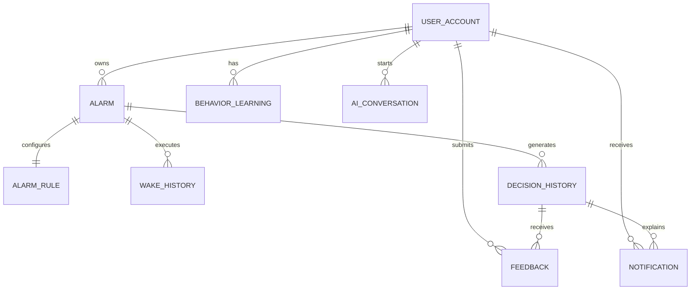

# WakeWise 数据库设计

| 属性 | 内容 |
|---|---|
| 版本 | v1.0.0 |
| 数据库 | MySQL 8.0+ |
| 字符集 | `utf8mb4` |
| 时间规范 | 持久化使用 UTC，展示时按用户时区转换 |
| ID 策略 | UUIDv7/ULID，示例类型 `CHAR(26)` |

## 1. 设计原则

- 核心业务使用关系模型保证事务一致性；天气和交通原始响应以 JSON 保存，标准化字段单独建列。
- 决策、通知、反馈不可硬删除；用户删除账户后按策略匿名化或清理。
- 位置、日历和会话遵循最小化存储，不保存决策不需要的完整原文。
- 所有表包含 `created_at`；可变业务表包含 `updated_at` 和乐观锁 `version`。
- 高频查询索引围绕“用户 + 状态 + 下一次时间”和“缓存键 + 预测时间”设计。

## 2. ER 模型

`weather_cache` 与 `traffic_cache` 是共享上下文缓存，不直接关联某个用户。`decision_history.context_snapshot_json` 仅保存决策所需特征、来源 ID 和数据版本。

## 3. 数据字典

### 3.1 `user_account` — 用户账户

| 字段 | 类型 | 约束 | 说明 |
|---|---|---|---|
| `id` | `CHAR(26)` | PK | 用户 ID |
| `email` | `VARCHAR(254)` | UNIQUE, NULL | 邮箱，第三方登录时可为空 |
| `phone_ciphertext` | `VARBINARY(512)` | NULL | 加密手机号，不支持明文检索 |
| `display_name` | `VARCHAR(80)` | NOT NULL | 显示名称 |
| `timezone` | `VARCHAR(64)` | NOT NULL | IANA 时区，如 `Asia/Shanghai` |
| `locale` | `VARCHAR(16)` | NOT NULL | 语言地区，如 `zh-CN` |
| `risk_preference` | `ENUM` | NOT NULL | `BALANCED/CONSERVATIVE/SLEEP_FIRST` |
| `automation_level` | `TINYINT` | NOT NULL | 0～3 |
| `status` | `ENUM` | NOT NULL | `ACTIVE/LOCKED/DELETING/DELETED` |
| `last_login_at` | `DATETIME(3)` | NULL | 最近登录时间 |
| `created_at` | `DATETIME(3)` | NOT NULL | 创建时间 |
| `updated_at` | `DATETIME(3)` | NOT NULL | 更新时间 |
| `version` | `BIGINT` | NOT NULL | 乐观锁版本 |

索引：`uk_user_email(email)`；如需手机号检索，额外保存带独立密钥的 HMAC，不对密文建模糊索引。

> 当前实现（V4 增列）：`home_address VARCHAR(160)`（常驻地址/家，真实 ETA 出发地）+ `home_lng DECIMAL(10,6)` / `home_lat DECIMAL(9,6)` 地理编码坐标缓存；`phone_ciphertext` 未建列。

### 3.2 `alarm` — 闹钟/晨间目标

| 字段 | 类型 | 约束 | 说明 |
|---|---|---|---|
| `id` | `CHAR(26)` | PK | 闹钟 ID |
| `user_id` | `CHAR(26)` | FK, NOT NULL | 所属用户 |
| `name` | `VARCHAR(100)` | NOT NULL | 用户可见名称 |
| `target_type` | `ENUM` | NOT NULL | `WAKE_AT/LEAVE_BY/ARRIVE_BY/EVENT` |
| `baseline_time` | `TIME` | NULL | 周期闹钟的基准时间 |
| `target_at` | `DATETIME(3)` | NULL | 一次性目标的 UTC 时间 |
| `calendar_event_ref` | `VARCHAR(160)` | NULL | 外部事件的不可逆/加密引用 |
| `destination_ciphertext` | `VARBINARY(1024)` | NULL | 加密后的目的地结构化数据 |
| `travel_mode` | `ENUM` | NULL | `WALK/BIKE/TRANSIT/DRIVE/MIXED/NONE` |
| `enabled` | `BOOLEAN` | NOT NULL | 是否启用 |
| `next_trigger_at` | `DATETIME(3)` | NULL | 下一次当前有效触发时间 |
| `created_at` | `DATETIME(3)` | NOT NULL | 创建时间 |
| `updated_at` | `DATETIME(3)` | NOT NULL | 更新时间 |
| `version` | `BIGINT` | NOT NULL | 乐观锁版本 |

索引：`idx_alarm_user_enabled(user_id, enabled)`、`idx_alarm_next_trigger(next_trigger_at, enabled)`。

> 当前实现（V4 增列）：`destination_label VARCHAR(120)` 明文 + `dest_lng/dest_lat DECIMAL` 地理编码坐标缓存（建闹钟时 best-effort 落库，估算时缺失则现查不回写）；设计中的 `target_at/calendar_event_ref/destination_ciphertext` 未建列，目标时间按 recurrence+`target_local_time` 推算。

### 3.3 `alarm_rule` — 闹钟规则

| 字段 | 类型 | 约束 | 说明 |
|---|---|---|---|
| `id` | `CHAR(26)` | PK | 规则 ID |
| `alarm_id` | `CHAR(26)` | FK, UNIQUE | 与闹钟一对一 |
| `rrule` | `VARCHAR(512)` | NULL | iCalendar RRULE 周期表达式 |
| `prep_duration_min` | `SMALLINT` | NOT NULL | 用户初始准备时长 |
| `max_advance_min` | `SMALLINT` | NOT NULL | 最大允许提前 |
| `max_delay_min` | `SMALLINT` | NOT NULL | 最大允许延后 |
| `allow_auto_delay` | `BOOLEAN` | NOT NULL | 是否允许自动延后 |
| `automation_level` | `TINYINT` | NOT NULL | 闹钟级自动化覆盖 |
| `snooze_interval_min` | `SMALLINT` | NOT NULL | 贪睡间隔 |
| `max_snooze_count` | `TINYINT` | NOT NULL | 最大贪睡次数 |
| `wake_strategy_json` | `JSON` | NOT NULL | 铃声、震动、渐亮等设置 |
| `effective_from` | `DATE` | NULL | 规则开始日期 |
| `effective_until` | `DATE` | NULL | 规则结束日期 |
| `created_at` | `DATETIME(3)` | NOT NULL | 创建时间 |
| `updated_at` | `DATETIME(3)` | NOT NULL | 更新时间 |

校验：`max_advance_min BETWEEN 0 AND 180`，`max_delay_min BETWEEN 0 AND 60`，具体产品上限可更严格。

### 3.4 `weather_cache` — 天气缓存

| 字段 | 类型 | 约束 | 说明 |
|---|---|---|---|
| `id` | `CHAR(26)` | PK | 快照 ID |
| `provider` | `VARCHAR(32)` | NOT NULL | 数据供应商 |
| `geo_hash` | `VARCHAR(12)` | NOT NULL | 降精度地理网格 |
| `forecast_time` | `DATETIME(3)` | NOT NULL | 预测目标时间 |
| `observed_at` | `DATETIME(3)` | NOT NULL | 数据获取时间 |
| `temperature_c` | `DECIMAL(5,2)` | NULL | 温度 |
| `feels_like_c` | `DECIMAL(5,2)` | NULL | 体感温度 |
| `precip_probability` | `DECIMAL(5,4)` | NULL | 降水概率 0～1 |
| `precip_mm` | `DECIMAL(8,2)` | NULL | 降水量 |
| `visibility_m` | `INT` | NULL | 能见度 |
| `wind_speed_mps` | `DECIMAL(6,2)` | NULL | 风速 |
| `aqi` | `SMALLINT` | NULL | 空气质量指数 |
| `alert_level` | `VARCHAR(24)` | NULL | 气象预警等级 |
| `quality_score` | `DECIMAL(5,4)` | NOT NULL | 数据质量 0～1 |
| `payload_json` | `JSON` | NOT NULL | 标准化后的扩展字段 |
| `expires_at` | `DATETIME(3)` | NOT NULL | 缓存失效时间 |
| `created_at` | `DATETIME(3)` | NOT NULL | 创建时间 |

唯一索引：`uk_weather(provider, geo_hash, forecast_time, observed_at)`；清理索引：`idx_weather_expire(expires_at)`。

### 3.5 `traffic_cache` — 交通缓存

| 字段 | 类型 | 约束 | 说明 |
|---|---|---|---|
| `id` | `CHAR(26)` | PK | 快照 ID |
| `provider` | `VARCHAR(32)` | NOT NULL | 数据供应商 |
| `route_key` | `CHAR(64)` | NOT NULL | 起终点网格、方式、偏好的哈希 |
| `departure_bucket` | `DATETIME(3)` | NOT NULL | 出发时间桶 |
| `travel_mode` | `ENUM` | NOT NULL | 交通方式 |
| `eta_p50_sec` | `INT` | NOT NULL | ETA 中位数 |
| `eta_p90_sec` | `INT` | NOT NULL | ETA 90 分位 |
| `distance_m` | `INT` | NULL | 路线距离 |
| `incident_count` | `SMALLINT` | NOT NULL | 事故/异常数量 |
| `quality_score` | `DECIMAL(5,4)` | NOT NULL | 数据质量 |
| `payload_json` | `JSON` | NOT NULL | 路线摘要，不保存不必要精确轨迹 |
| `observed_at` | `DATETIME(3)` | NOT NULL | 采集时间 |
| `expires_at` | `DATETIME(3)` | NOT NULL | 失效时间 |
| `created_at` | `DATETIME(3)` | NOT NULL | 创建时间 |

索引：`idx_traffic_lookup(route_key, departure_bucket, observed_at)`、`idx_traffic_expire(expires_at)`。

> 当前实现（V4）：已建表，`route_key` 为 `o<起点4dp>|d<终点4dp>|m<方式>`（≤64 字符），`eta_p90_sec` 由 p50 × 方式尾部系数推导；`departure_bucket/incident_count/payload_json` 未建列（MVP 用 2 小时 TTL 快照，不区分出发时段桶），数据源为高德路径规划。

### 3.6 `wake_history` — 晨间执行历史

| 字段 | 类型 | 约束 | 说明 |
|---|---|---|---|
| `id` | `CHAR(26)` | PK | 记录 ID |
| `user_id` | `CHAR(26)` | FK, NOT NULL | 用户 ID，便于按用户查询/清理 |
| `alarm_id` | `CHAR(26)` | FK, NOT NULL | 闹钟 ID |
| `plan_id` | `CHAR(26)` | NULL | 对应决策计划 |
| `scheduled_at` | `DATETIME(3)` | NOT NULL | 最终调度时间 |
| `triggered_at` | `DATETIME(3)` | NULL | 设备实际触发时间 |
| `dismissed_at` | `DATETIME(3)` | NULL | 关闭时间 |
| `woke_at` | `DATETIME(3)` | NULL | 推断/确认离床时间 |
| `departed_at` | `DATETIME(3)` | NULL | 推断/确认出发时间 |
| `arrived_at` | `DATETIME(3)` | NULL | 推断/确认到达时间 |
| `snooze_count` | `TINYINT` | NOT NULL | 贪睡次数 |
| `outcome` | `ENUM` | NOT NULL | `SUCCESS/LATE/MISSED/UNKNOWN` |
| `source_flags` | `SET` | NULL | `USER/DEVICE/LOCATION/CALENDAR` 等 |
| `created_at` | `DATETIME(3)` | NOT NULL | 创建时间 |

索引：`idx_wake_user_time(user_id, scheduled_at)`、`idx_wake_alarm_time(alarm_id, scheduled_at)`。

> 当前实现：`woke_at/departed_at/arrived_at/source_flags` 未建列；V2 迁移以 `left_home_at DATETIME(3) NULL` 落地 `departed_at` 的第一期形态——由 `USER_LEFT_HOME` 事件（出门打卡）写入，只积累数据、暂不参与决策。

### 3.7 `decision_history` — 决策历史

| 字段 | 类型 | 约束 | 说明 |
|---|---|---|---|
| `id` | `CHAR(26)` | PK | 决策记录 ID |
| `plan_id` | `CHAR(26)` | UNIQUE | 跨端计划 ID |
| `user_id` | `CHAR(26)` | FK, NOT NULL | 用户 ID |
| `alarm_id` | `CHAR(26)` | FK, NOT NULL | 闹钟 ID |
| `baseline_at` | `DATETIME(3)` | NOT NULL | 原计划时间 |
| `recommended_at` | `DATETIME(3)` | NOT NULL | 推荐时间 |
| `effective_at` | `DATETIME(3)` | NULL | 用户确认/自动生效时间 |
| `status` | `ENUM` | NOT NULL | `PROPOSED/PENDING/ARMED/REVERTED/FAILED/EXECUTED` |
| `risk_score` | `DECIMAL(7,4)` | NOT NULL | 风险分数 |
| `late_probability` | `DECIMAL(6,5)` | NOT NULL | 预计迟到概率 |
| `confidence` | `DECIMAL(5,4)` | NOT NULL | 决策置信度 |
| `factor_contribution_json` | `JSON` | NOT NULL | 可解释因素贡献 |
| `context_snapshot_json` | `JSON` | NOT NULL | 最小化上下文与来源引用 |
| `reason_code` | `VARCHAR(64)` | NOT NULL | 稳定的主原因码 |
| `explanation` | `VARCHAR(1000)` | NOT NULL | 用户可见解释 |
| `policy_version` | `VARCHAR(40)` | NOT NULL | 策略版本 |
| `model_version` | `VARCHAR(40)` | NOT NULL | 模型版本 |
| `prompt_version` | `VARCHAR(40)` | NULL | 若使用 LLM 解释则记录 |
| `created_at` | `DATETIME(3)` | NOT NULL | 创建时间 |
| `updated_at` | `DATETIME(3)` | NOT NULL | 更新时间 |
| `version` | `BIGINT` | NOT NULL | 乐观锁/计划版本 |

索引：`idx_decision_alarm_time(alarm_id, created_at)`、`idx_decision_user_status(user_id, status, created_at)`。

### 3.8 `behavior_learning` — 行为学习参数

| 字段 | 类型 | 约束 | 说明 |
|---|---|---|---|
| `id` | `CHAR(26)` | PK | 参数记录 ID |
| `user_id` | `CHAR(26)` | FK, NOT NULL | 用户 ID |
| `segment_key` | `VARCHAR(100)` | NOT NULL | 如 `weekday+rain+transit` |
| `feature_key` | `VARCHAR(64)` | NOT NULL | `WAKE_LATENCY/PREP_DURATION/...` |
| `estimate` | `DECIMAL(12,4)` | NOT NULL | 当前估计值 |
| `variance` | `DECIMAL(14,6)` | NULL | 不确定性 |
| `sample_count` | `INT` | NOT NULL | 有效样本数 |
| `last_sample_at` | `DATETIME(3)` | NULL | 最近样本时间 |
| `algorithm_version` | `VARCHAR(40)` | NOT NULL | 学习算法版本 |
| `created_at` | `DATETIME(3)` | NOT NULL | 创建时间 |
| `updated_at` | `DATETIME(3)` | NOT NULL | 更新时间 |

唯一索引：`uk_behavior(user_id, segment_key, feature_key)`。

> 当前实现（SHRINK_V1）：`segment_key` 一期固定 `ALL`，`feature_key` 仅用 `WAKE_LATENCY`；`estimate` 存校准后 P50（分钟）、`variance` 存分钟²，P90 = estimate + 1.2816 × √variance（与引擎 sigma 公式自洽）；样本不足 5 条时写入全局先验 4/8。写入时机：`ALARM_DISMISSED` 事件提交后重算（单一写入点，变更可追溯到一次明确的关闭事件）。

### 3.9 `notification` — 通知记录

| 字段 | 类型 | 约束 | 说明 |
|---|---|---|---|
| `id` | `CHAR(26)` | PK | 通知 ID |
| `user_id` | `CHAR(26)` | FK, NOT NULL | 接收用户 |
| `decision_id` | `CHAR(26)` | FK, NULL | 关联决策 |
| `type` | `VARCHAR(40)` | NOT NULL | 调整、确认、风险、系统状态等 |
| `channel` | `ENUM` | NOT NULL | `IN_APP/PUSH/EMAIL/WEARABLE` |
| `title` | `VARCHAR(160)` | NOT NULL | 标题 |
| `body` | `VARCHAR(1000)` | NOT NULL | 正文 |
| `status` | `ENUM` | NOT NULL | `PENDING/SENT/DELIVERED/OPENED/FAILED` |
| `provider_message_id` | `VARCHAR(160)` | NULL | 渠道消息 ID |
| `idempotency_key` | `VARCHAR(100)` | UNIQUE | 防重复键 |
| `sent_at` | `DATETIME(3)` | NULL | 发送时间 |
| `delivered_at` | `DATETIME(3)` | NULL | 送达时间 |
| `opened_at` | `DATETIME(3)` | NULL | 打开时间 |
| `failure_code` | `VARCHAR(64)` | NULL | 失败原因码 |
| `created_at` | `DATETIME(3)` | NOT NULL | 创建时间 |

索引：`idx_notification_user_time(user_id, created_at)`、`idx_notification_status(status, created_at)`。

### 3.10 `feedback` — 用户反馈

| 字段 | 类型 | 约束 | 说明 |
|---|---|---|---|
| `id` | `CHAR(26)` | PK | 反馈 ID |
| `user_id` | `CHAR(26)` | FK, NOT NULL | 用户 ID |
| `decision_id` | `CHAR(26)` | FK, NULL | 关联决策 |
| `wake_history_id` | `CHAR(26)` | FK, NULL | 关联执行历史 |
| `rating` | `TINYINT` | NOT NULL | 1～5 或映射后的评分 |
| `reason_code` | `VARCHAR(64)` | NOT NULL | `TOO_EARLY/JUST_RIGHT/TOO_LATE/WRONG_REASON/...` |
| `comment` | `VARCHAR(1000)` | NULL | 可选文本反馈 |
| `created_at` | `DATETIME(3)` | NOT NULL | 创建时间 |

索引：`idx_feedback_decision(decision_id)`、`idx_feedback_user_time(user_id, created_at)`。

### 3.11 `ai_conversation` — AI 助手会话

| 字段 | 类型 | 约束 | 说明 |
|---|---|---|---|
| `id` | `CHAR(26)` | PK | 消息 ID |
| `user_id` | `CHAR(26)` | FK, NOT NULL | 用户 ID |
| `session_id` | `CHAR(26)` | NOT NULL | 会话 ID |
| `role` | `ENUM` | NOT NULL | `USER/ASSISTANT/TOOL` |
| `content_json` | `JSON` | NOT NULL | 脱敏后的结构化内容 |
| `tool_name` | `VARCHAR(80)` | NULL | 工具调用名称 |
| `tool_call_id` | `VARCHAR(100)` | NULL | 工具调用关联 ID |
| `model_name` | `VARCHAR(80)` | NULL | 模型名称 |
| `token_usage_json` | `JSON` | NULL | 成本统计 |
| `retention_until` | `DATETIME(3)` | NOT NULL | 自动清理时间 |
| `created_at` | `DATETIME(3)` | NOT NULL | 创建时间 |

索引：`idx_conversation_session(session_id, created_at)`、`idx_conversation_retention(retention_until)`。

### 3.12 `device_event` — 设备事件流水（V3 实装）

| 字段 | 类型 | 约束 | 说明 |
|---|---|---|---|
| `id` | `CHAR(26)` | PK | 记录 ID |
| `event_id` | `VARCHAR(64)` | UNIQUE, NOT NULL | 客户端生成的事件 ID（`evt-` + UUID），全局去重键 |
| `user_id` | `CHAR(26)` | FK, NOT NULL | 用户 ID |
| `plan_id` | `CHAR(26)` | NOT NULL | 关联决策计划 |
| `type` | `VARCHAR(32)` | NOT NULL | `ALARM_FIRED/ALARM_SNOOZED/ALARM_DISMISSED/USER_LEFT_HOME` |
| `occurred_at` | `DATETIME(3)` | NULL | 客户端上报时刻，缺省为服务端接收时刻 |
| `received_at` | `DATETIME(3)` | NOT NULL | 服务端接收时刻 |

索引：`uk_device_event(event_id)` 唯一。

> 事件入口先按 `event_id` 存在性跳过重复（outbox 重放/客户端重试返回成功以便清理 outbox），并发窗口内的重复由唯一约束回滚兜底——修复 `ALARM_SNOOZED` 重复上报多计贪睡次数的口子。

## 4. 关系与一致性规则

1. 删除/停用 `alarm` 时不删除历史决策与执行记录，只进行状态变更。
2. `decision_history.status=ARMED` 前必须存在客户端 ACK；ACK 事件以 `plan_id + device_id` 幂等。
3. 新计划 `ARMED` 后，事务性标记同一闹钟旧计划为 `SUPERSEDED`；客户端先加新后删旧。
4. 行为学习任务只消费已达到质量要求的 `wake_history`，人工纠正优先于自动推断。
5. 天气、路况缓存到期后可保留用于离线评估，但在线读取必须判断 `expires_at`。

## 5. 数据生命周期

| 数据 | 默认保留建议 | 用户控制 |
|---|---:|---|
| 天气/路况共享缓存 | 7～30 天 | 不包含直接用户标识 |
| 详细执行历史 | 12 个月 | 可导出、可清除 |
| 聚合行为参数 | 账户存续期 | 可重置个性化模型 |
| 决策审计 | 12～24 个月 | 删除账户后匿名化/清理 |
| AI 会话 | 30～90 天 | 可关闭保存、随时删除 |
| 通知记录 | 90 天 | 可清理历史 |

保留期应根据实际司法辖区、产品政策和供应商许可进一步评审。

## 6. 分库分表与分析演进

MVP 不做分库分表。数据增长后按以下顺序演进：

1. 将过期天气/交通缓存迁移到对象存储或直接清理。
2. 将决策和执行事件通过 CDC/消息流写入分析仓库。
3. 高频任务按 `user_id` 哈希分片，但账户与闹钟保持同分片。
4. 在线事务库不承载大范围行为分析和模型训练扫描。

